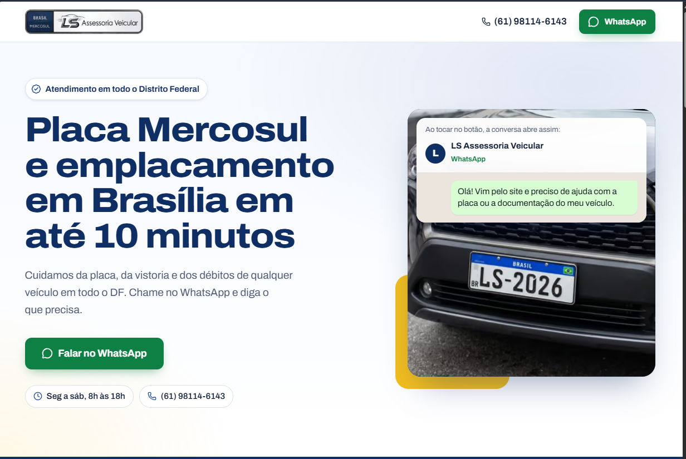

# Landing page — LS Assessoria Veicular (Next.js + Docker)



Página única, gerada como **HTML estático** (o Google lê tudo na hora, sem depender de JavaScript), com botões de WhatsApp rastreáveis, dados estruturados de negócio local e pronta para rodar atrás do Caddy.

**Situação atual:** versão de teste em `https://ls.vhmedeiros.dev.br`. Todas as informações do cliente foram confirmadas — zero pendências. Próximo passo: passar para o domínio definitivo (veja [Passar para o domínio definitivo](#passar-para-o-domínio-definitivo)).

## Onde mexer

| O que | Arquivo |
|---|---|
| Textos, WhatsApp, endereço, horário, serviços, FAQ, SEO | `src/config/site.ts` |
| Cores da marca | topo de `src/app/globals.css` (`:root`) |
| Logos e foto do hero | `public/brand/` (`logo-horizontal.png`, `logo-quadrado.jpg`, `hero-carro.jpg`) |
| Ícones da aba | `src/app/icon.png`, `src/app/apple-icon.png`, `src/app/favicon.ico` |
| Imagem de compartilhamento (WhatsApp, redes) | `src/app/opengraph-image.jpg` e `twitter-image.jpg` (+ `.alt.txt`) |
| SEO técnico | `src/app/layout.tsx`, `src/components/JsonLd.tsx`, `src/app/sitemap.ts`, `src/app/robots.ts` |
| Política de privacidade | `src/app/politica-de-privacidade/page.tsx` |
| Domínio, modo de teste, indexação, IDs de rastreamento | `.env` (copie de `.env.example`) |
| Lista de palavras-chave do cliente (para o Google Ads) | `docs/palavras-chave.txt` |

> **Nenhum domínio fica fixo no código.** Canonical, sitemap, robots.txt, JSON-LD e imagem de compartilhamento usam `SITE_URL`.

## Variáveis principais (`.env`)

| Variável | Teste | Final | O que faz |
|---|---|---|---|
| `SITE_URL` | `https://ls.vhmedeiros.dev.br` | domínio do cliente | endereço do site, sem barra no fim |
| `SHOW_PENDING` | `true` | `false` | selos amarelos "Falta confirmar", faixa no topo e lista de pendências |
| `ALLOW_INDEXING` | `false` | `true` | libera o Google (meta robots, cabeçalho `X-Robots-Tag` e robots.txt) |

**Trava:** `ALLOW_INDEXING=true` junto com `SHOW_PENDING=true` faz o build **falhar** de propósito: a versão de teste nunca pode ir para o Google.

Tudo isso entra **no build** (a página é HTML estático): mudou o `.env`, rode `docker compose up -d --build`.

## Sistema de pendências

Tudo que o cliente ainda não confirmou fica numa lista só, `pendencias`, em `src/config/site.ts`. Dela saem:

- os **selos amarelos** na página (`<Pendente id="..." />`), com o número da pendência;
- a **faixa do topo** ("Versão de teste — ... (N pendências)");
- a **seção "Pendências para confirmar"** no fim da página, agrupada por seção;
- o arquivo **`PENDENCIAS.md`**, com o texto pronto para mandar no WhatsApp do cliente.

Enquanto uma informação não é confirmada, o campo usa um **texto neutro e verdadeiro** e é marcado com `p("id")` e um comentário `// PENDENTE`. Pendências nunca entram no JSON-LD, no `<title>`, na meta description nem nas imagens de compartilhamento.

### Como resolver uma pendência

1. Preencha o dado real em `src/config/site.ts`.
2. Apague a entrada da lista `pendencias`.
3. Rode `npm run typecheck`: o TypeScript aponta onde o id ainda é usado. Apague o `pendente: p("...")` ou troque por `null`.
4. Rebuild: `npm run build` ou `docker compose up -d --build`. O `PENDENCIAS.md` se atualiza junto.

## Itens para acompanhar (sem bloquear o lançamento)

Estes dados ainda não existem, mas **não impedem a publicação**. Atualizar o `site.ts` quando o cliente criar:

- **E-mail** (`email: ""`) — aparece automaticamente no rodapé e no JSON-LD quando preenchido.
- **Instagram** (`social.instagram: ""`) — aparece no rodapé quando preenchido.
- **Perfil Google Meu Negócio** (`social.googleBusiness: ""`) — entra no JSON-LD (`sameAs`).
- **Depoimentos** (`testimonials: []`) — a seção aparece na página ao adicionar o primeiro.
- **Razão social completa** — atualmente MEI (Lincoln Sergio Alves Araujo Flor). Atualizar `legalName` se houver abertura de empresa.

## Rodar no seu computador

Precisa de Node 20.9 ou mais novo.

```bash
npm install
cp .env.example .env
npm run dev        # http://localhost:3000
```

## Publicar a versão de teste na VM (Oracle A1 ARM64)

A VM já roda outros projetos. O Caddy roda **em container** (`lupa-caddy`), lê o Caddyfile de `~/dashboard-lupa/Caddyfile` e chama cada site pelo nome do container. Este site sobe como o container `ls-landing` e entra na rede do Caddy pelo arquivo `docker-compose.caddy.yml`.

1. **Clonar** (o DNS de `ls.vhmedeiros.dev.br` já aponta para a VM):
   ```bash
   cd ~ && git clone https://github.com/vhmedeiros/landing-page-ls.git && cd landing-page-ls
   ```
2. **Descobrir a rede do Caddy:**
   ```bash
   docker inspect lupa-caddy --format '{{range $k, $v := .NetworkSettings.Networks}}{{$k}} {{end}}'
   ```
3. **Criar o `.env`:** `cp .env.example .env`, depois descomentar as duas linhas da seção "Caddy em container" e colocar em `PROXY_NETWORK` o nome que o passo 2 mostrou.
4. **Subir e testar na própria VM:**
   ```bash
   docker compose up -d --build
   docker compose ps                      # ls-landing "healthy" depois de ~30 s
   curl -sI http://127.0.0.1:3010 | grep -iE '^HTTP|x-robots'
   ```
5. **Caddy:** acrescentar o bloco ao Caddyfile do Caddy e recarregar:
   ```bash
   docker exec lupa-caddy caddy reload --config /etc/caddy/Caddyfile
   ```
6. **Conferir de fora:** `curl -sI https://ls.vhmedeiros.dev.br` e colar o link no WhatsApp para ver a prévia.

**Atualizar depois:** `cd ~/landing-page-ls && git pull && docker compose up -d --build`. O `.env` fica só na VM (não vai para o git).

## Passar para o domínio definitivo

1. **DNS do domínio do cliente** apontando para a VM (registro `A` do domínio e do `www`).
2. **`.env`:**
   ```
   SITE_URL=https://www.dominiodocliente.com.br
   SHOW_PENDING=false
   ALLOW_INDEXING=true
   ```
3. **Caddy:** use os blocos comentados no fim de `Caddyfile.example`: domínio novo com `reverse_proxy`, domínio sem `www` redirecionando para o com `www`, e o **301 do subdomínio de teste** para o domínio novo:
   ```
   ls.vhmedeiros.dev.br {
   	redir https://www.dominiodocliente.com.br{uri} permanent
   }
   ```
4. `docker compose up -d --build` e recarregue o Caddy.
5. Confira: `curl -sI https://www.dominiodocliente.com.br` **sem** `X-Robots-Tag`, `/robots.txt` com `Allow: /`, e `curl -sI https://ls.vhmedeiros.dev.br` respondendo `301`.
6. **Google Search Console:** cadastre o domínio novo e envie `https://www.dominiodocliente.com.br/sitemap.xml`.
7. Preencha os IDs de rastreamento (GTM, GA4, Ads, Pixel) no `.env` quando for rodar anúncios.

## Rastreamento de WhatsApp (para o tráfego pago)

Todo clique em botão de WhatsApp dispara:

- `dataLayer.push({ event: "whatsapp_click", whatsapp_source })`: no GTM, crie um acionador **Evento personalizado** `whatsapp_click`.
- GA4: evento `whatsapp_click`.
- Google Ads: conversão `NEXT_PUBLIC_GOOGLE_ADS_ID/NEXT_PUBLIC_GOOGLE_ADS_WA_LABEL`.
- Meta Pixel: evento padrão `Contact`.

`whatsapp_source` diz qual botão foi clicado (`topo`, `hero`, `servico:Nome`, `cta-final`, `flutuante`). Cada serviço abre o WhatsApp com uma mensagem diferente, então dá para saber pelo texto qual serviço o cliente queria.

> Se usar GTM, configure GA4/Ads/Pixel **dentro** dele e deixe as outras variáveis vazias. Senão as conversões contam em dobro. Na versão de teste, deixe todos vazios.

## SEO: o que não fazer

- Não criar uma página por região administrativa (doorway page: o Google trata como spam). As regiões ficam numa frase só, em "Onde estamos".
- Não esconder texto nem encher parágrafo de palavra-chave.

## Botão de WhatsApp no resultado do Google

Isso **não vem do site**: vem do **Perfil da Empresa no Google**. Depois do perfil verificado: *Editar perfil → Contato → Chat* e cole o link `https://wa.me/5561981146143`. O site ajuda o perfil a ranquear (mesmo nome, endereço e telefone nos dois lugares), mas o botão é configurado lá. Quando o perfil existir, coloque o link em `social.googleBusiness` no `site.ts`.
